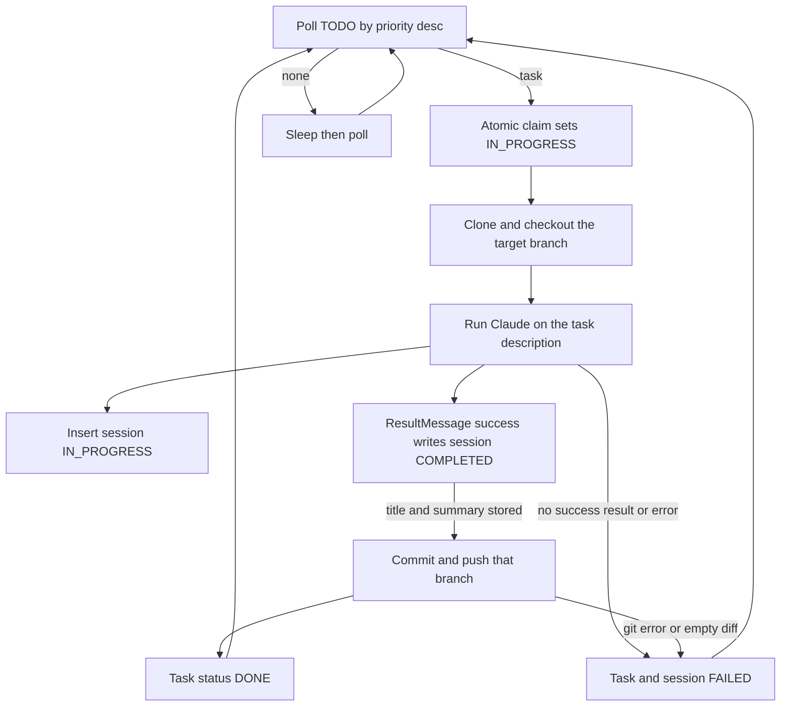

# MongoDB Orchestrator for Claude Agent SDK

`main.py` is a long-running worker that bridges MongoDB-based task orchestration with the Claude Agent SDK. It claims coding tasks, provisions ephemeral workspaces, delegates the work to the AI agent, and pushes the final commits back to the remote repository.

By introducing a Python orchestrator backed by MongoDB, this architecture provides several key advantages:

- **Tracker Agnostic:** Decouples AI task execution from any specific issue tracking system (e.g., Jira, GitHub Issues, ...).
- **Priority-Based Scheduling:** Replaces standard FIFO queues with out-of-order processing, ensuring high-priority tasks are always claimed first.
- **Safe Concurrency:** Scales horizontally across multiple containers or VMs. MongoDB's atomic operations guarantee transactional task claims, ensuring parallel workers never pick up the same task.
- **Unified Auditing:** MongoDB stores both the orchestration metadata and the agent's internal state (via the PyPI package [`claude-agent-sdk-mongodb-session-store`](https://github.com/mongodb-developer/claude-agent-sdk-mongodb-session-store)). A shared `session_id` seamlessly correlates the orchestrator's lifecycle with Claude's full execution transcripts for precise troubleshooting.
- **Ephemeral Workspaces:** Uses temporary directories to provide a clean, isolated environment for every task, eliminating artifact bleed-through from previous runs.
- **Reduced Host Dependencies:** Highly portable. It makes minimal assumptions about the host system, requiring no pre-installed Git or SSH executables, and interacts with the repository strictly for clone, branch, and push operations.

## Prerequisites

- Python 3.10 or newer, and `pip`. The [Docker image](Dockerfile) uses Python 3.12.
- MongoDB 7.0 or later, as Community, Enterprise Advanced, or Atlas. The worker needs only the connection string in `MONGO_CONN_STR`.
- Model access for the Claude Agent SDK: `CLAUDE_MODEL`, `CLAUDE_API_KEY`, and `CLAUDE_API_URL`. `CLAUDE_API_URL` is the base URL of an Anthropic Messages API endpoint. The [configuration example](#configuration) uses Anthropic directly. The same variable can point at a proxy or a gateway that implements that API, including one that routes to Amazon Bedrock, Microsoft Foundry, or Google Cloud's Agent Platform (formerly Vertex AI).
- SSH access to the Git host: `GIT_HOST`, a private key at `GIT_SSH_KEY_PATH`, and a matching entry in `$HOME/.ssh/known_hosts` unless `STRICT_HOST_CHECKING` is false. The `git` and `ssh` executables are not required.
- The packages in [`requirements.txt`](requirements.txt), installed with `pip install -r requirements.txt`. `claude-agent-sdk` is Anthropic's Python SDK. [`claude-agent-sdk-mongodb-session-store`](https://github.com/mongodb-developer/claude-agent-sdk-mongodb-session-store) is a PyPI package published by MongoDB. It is not a module in this repository, and it is not part of the Anthropic SDK. It provides `MongoDBSessionStore`.

Use the `.env` example in [Configuration](#configuration), insert a `TODO` task, then start the worker as described in [Run](#run).

## Loop

1. Poll the `tasks` collection in the `mongodb_claude_orchestrator` database and claim the `TODO` task with the highest `priority`. The claim is an atomic `findOneAndUpdate`: it sets `status` to `IN_PROGRESS`. Two workers cannot claim the same task.
2. If that collection has no `TODO` task, sleep 5 seconds and poll it again.
3. Clone the Git repo into a temporary directory and check out the task's base branch.
4. When `create_feature_branch` is true (the default), create and check out a new branch named `agent/<task id>`. Otherwise stay on the task's branch.
5. Run the Claude Agent SDK with the task `description` as the user prompt and the system prompt hardcoded in `config/config.py` (see [System prompt](#system-prompt)). The worker does not read that prompt from `.env`. It stays in code so the agent closes with a descriptive summary, which the worker stores and later writes into the Git commit. The working directory is the temporary clone. `Read`, `Edit`, and `Glob` are auto-approved. After the session document exists, every later message `query()` yields refreshes that session's `updated_at`, whatever the message type.
6. While the agent works, its status is recorded in MongoDB by updating the `sessions` collection in the `mongodb_claude_orchestrator` database. When the first init message arrives, insert a session document there with status `IN_PROGRESS`, the task id, the branch that will receive the commit, and `updated_at`.
7. When a result message arrives with subtype `success`, `is_error` false, and a non-empty result text, the worker updates that session document in the same collection: status `COMPLETED`, `commit_title` set to the task id, `summary` set to the result text, and `updated_at` refreshed. A success result with `is_error` true, or an empty result, does not update the session.
8. After the agent message loop:
   - If the run errors, or the session was not completed with a title and summary, do not commit. Set the task to `FAILED`. If a session document was created, set it to `FAILED` too.
   - Otherwise stage the worktree. If it differs from `HEAD`, commit with the task id, a blank line, the task description, a blank line, and the summary, then push that branch to `origin`. The summary is the agent's final message, the description of what was done. Set the task to `DONE`.
   - If there is nothing to commit, or clone, commit, or push fails, set the task to `FAILED` and set the session to `FAILED` when one exists.
9. Delete the temporary directory and poll again.

Commits are authored as `GIT_AUTHOR_NAME <GIT_AUTHOR_EMAIL>`. Clone and push use the SSH private key in `GIT_SSH_KEY_PATH` through pygit2. The server host key must match `$HOME/.ssh/known_hosts` unless `STRICT_HOST_CHECKING` is false. See [SSH](#ssh).



## If the worker stops

Inserting a session writes `updated_at`. Every later message from `query()` refreshes it while the session is still `IN_PROGRESS`. The worker also writes `updated_at` when it sets the session to `COMPLETED` or `FAILED`. The timestamp does not move during clone, while `query()` waits for the next message, or during commit and push. Messages that arrive before the session document exists do not write a timestamp.

If the process is killed, the task stays `IN_PROGRESS`. A session that was already inserted stays `IN_PROGRESS` too. This worker leaves them there on purpose. A session can be short or very long depending on the task given to the agent, and a fixed cutoff would close runs that are still valid. A job outside this repository can apply its own threshold using the session's `updated_at`. The sessions `(status, updated_at)` index exists for that job. A claimed task with no session has no heartbeat.

## MongoDB

The worker uses two databases on the connection string in `MONGO_CONN_STR`. That string works with MongoDB 7.0 or later on Community, Enterprise Advanced, or Atlas.

| Database | Contents |
| --- | --- |
| `mongodb_claude_orchestrator` | Task and session metadata written by this worker |
| `claude` | Claude Agent SDK transcripts. `main.py` uses `MongoDBSessionStore` from the PyPI package `claude-agent-sdk-mongodb-session-store` (pinned in `requirements.txt`) |

### `mongodb_claude_orchestrator.tasks`

| Field | Meaning |
| --- | --- |
| `task_id` | Application id used to look up and update the task |
| `status` | `TODO`, `IN_PROGRESS`, `DONE`, or `FAILED` |
| `priority` | Integer. Higher values are claimed first |
| `repo` | Path under the Git host, such as `owner/myproject` |
| `branch` | Branch to clone. Receives the commit when `create_feature_branch` is false |
| `description` | Prompt passed to the agent unchanged |
| `create_feature_branch` | When true (the default), commit on a new `agent/<task id>` branch. When false, commit on `branch` |

```json
{
  "task_id": "review-crash-bugs",
  "status": "TODO",
  "priority": 10,
  "repo": "owner/myproject",
  "branch": "main",
  "description": "Review the python files for crash bugs and fix them.",
  "create_feature_branch": true
}
```

A task moves `TODO` to `IN_PROGRESS` when claimed. It becomes `DONE` only after the branch is pushed. It becomes `FAILED` when preparation, the agent run, recording a successful result, the commit, or the push does not succeed. A failed task stays `FAILED`; the worker does not put it back on the queue. A task left `IN_PROGRESS` when the process stops stays `IN_PROGRESS`.

### `mongodb_claude_orchestrator.sessions`

| Field | Meaning |
| --- | --- |
| `session_id` | Id from the agent's init message |
| `status` | `IN_PROGRESS`, `COMPLETED`, or `FAILED` |
| `task_id` | Id of the claimed task |
| `feature_branch` | Branch that receives the commit: `agent/<task id>` when `create_feature_branch` is true, otherwise the task's `branch` |
| `commit_title` | The task id, written by the worker when the run succeeds |
| `summary` | The agent's final result text, written by the worker when the run succeeds. This is the descriptive message the system prompt requires, and the text appended to the Git commit |
| `updated_at` | UTC healthcheck. Written when the session is inserted, refreshed on every later message from `query()` while the session is `IN_PROGRESS`, and written again when the session becomes `COMPLETED` or `FAILED` |

The session is inserted as `IN_PROGRESS` on init, with `updated_at` set. On a successful result the worker sets `COMPLETED`, `commit_title`, `summary`, and refreshes `updated_at`. A later failure of the commit or push moves that session to `FAILED` and refreshes `updated_at`.

Indexes created at startup: `tasks` on `(status, priority)`, a unique index on `tasks.task_id`, a unique index on `sessions.session_id`, and `sessions` on `(status, updated_at)`. The sessions `(status, updated_at)` index is for a job outside this repository. A claimed task with no session has no heartbeat. Startup drops `status_updated_at_idx` from `tasks` when that index is already present. The SDK session store also creates its own indexes in the `claude` database.

## Configuration

`.env` supplies:

- `MONGO_CONN_STR`
- `CLAUDE_MODEL` — model id accepted by the endpoint
- `CLAUDE_API_KEY` — credential forwarded as `ANTHROPIC_API_KEY`. The `sk-ant-` value in the example is a direct Anthropic key.
- `CLAUDE_API_URL` — Anthropic Messages API base URL, forwarded as `ANTHROPIC_BASE_URL`. The example uses `https://api.anthropic.com`. Any compatible proxy or gateway URL is valid.
- `GIT_HOST` — SSH base for clone URLs, such as `ssh://git@github.com`
- `GIT_SSH_KEY_PATH` — path to the private key used for clone and push. If `<path>.pub` exists, that public key is sent with it.
- `STRICT_HOST_CHECKING` — when unset or true, compare the server host key with `$HOME/.ssh/known_hosts`. Set to `false` to accept any host key.
- `GIT_AUTHOR_NAME` — name recorded on each commit
- `GIT_AUTHOR_EMAIL` — email recorded on each commit

```bash
MONGO_CONN_STR=mongodb://localhost:27017
CLAUDE_MODEL=claude-3-5-sonnet-20241022
CLAUDE_API_KEY=sk-ant-example
CLAUDE_API_URL=https://api.anthropic.com
GIT_HOST=ssh://git@github.com
GIT_SSH_KEY_PATH=/home/agent/.ssh/id_ed25519
STRICT_HOST_CHECKING=true
GIT_AUTHOR_NAME=Agent
GIT_AUTHOR_EMAIL=agent@example.com
```

### Model endpoint

`process_task` passes `CLAUDE_API_KEY` to the SDK as `ANTHROPIC_API_KEY` and `CLAUDE_API_URL` as `ANTHROPIC_BASE_URL`. The example above is direct Anthropic: a key of the form `sk-ant-...` and `https://api.anthropic.com`.

`CLAUDE_API_URL` can be the base URL of a corporate proxy or an LLM gateway that serves the Anthropic Messages API at `/v1/messages`. The SDK then treats that URL as the Claude API. The gateway can forward to Anthropic, or to Amazon Bedrock, Microsoft Foundry, or Google Cloud's Agent Platform (formerly Vertex AI). This worker does not choose the upstream. Put the credential that endpoint expects in `CLAUDE_API_KEY`. A gateway key may use any prefix. `CLAUDE_MODEL` must be a model id that endpoint accepts.

`CLAUDE_CODE_USE_BEDROCK`, `CLAUDE_CODE_USE_FOUNDRY`, and `CLAUDE_CODE_USE_VERTEX` are outside this configuration. This worker does not read them from `.env`.

### System prompt

`system_prompt` is a string constant in `config/config.py`. The worker does not load it from `.env`, and it does not generate it at runtime. `main()` passes `config.system_prompt` to `process_task`, which sets `ClaudeAgentOptions.system_prompt`.

The prompt is hardcoded because the agent's final message is the description the orchestrator writes on the Git commit. The task `description` says what to do, and the worker copies it into the commit as well. The system prompt adds the reporting rule: when the work is finished, reply with a summary of the tasks performed and the assumptions made.

On a successful result, the worker stores that reply as `sessions.summary`. `commit_and_push` builds the commit message from three parts, separated by blank lines: the task id, the task `description`, and that summary. It then pushes the branch. A success result with empty result text does not update the session, so the worker does not commit and the task becomes `FAILED`.

Leaving the prompt in code keeps that closing instruction on every run. The commit on the remote repository then records what the agent did and which assumptions it made.

```text
The current working directory contains a code repo. Perform the actions described in the prompt you are given by the user.
When the work is finished, reply with a summary of the tasks performed and the assumptions made.
```

### SSH

Clone and push go through pygit2, which links libgit2 and libssh2. The worker does not call the `git` or `ssh` executables, and it does not read OpenSSH `StrictHostKeyChecking`.

By default, clone and push compare the server host key with `$HOME/.ssh/known_hosts`. `STRICT_HOST_CHECKING` is true when unset. The file must already contain the host, for example from `ssh-keyscan` or a copied `known_hosts`. An unknown or changed key fails the clone or push. The task is then marked `FAILED`, and the error is written to stderr.

`HOME` must be set: libgit2 opens `$HOME/.ssh/known_hosts` while starting the SSH session. A missing file counts as not trusted while checking is on, so the connection fails. An unreadable file, or a missing `HOME`, fails the clone or push either way.

> **Warning:** `STRICT_HOST_CHECKING=false` accepts the server host key with no prompt and no comparison against `known_hosts`. A network attacker can impersonate the Git host. Use that only for local automation that cannot keep a `known_hosts` file.

## Run

The host needs Python 3.10 or newer, with `HOME` set. The `git` and `ssh` executables are not required. pygit2 wheels include libgit2 and libssh2.

```bash
pip install -r requirements.txt
python main.py
```

Insert `TODO` task documents into `mongodb_claude_orchestrator.tasks` before starting the worker. The process polls until it is stopped.

### Docker

Alternatively, build and run the worker in a container:

```bash
docker build -t mongodb-claude-orchestrator .

docker run --rm \
  --env-file .env \
  -e GIT_SSH_KEY_PATH=/keys/id_ed25519 \
  -v "$HOME/.ssh/id_ed25519:/keys/id_ed25519:ro" \
  -v "$HOME/.ssh/id_ed25519.pub:/keys/id_ed25519.pub:ro" \
  -v "$HOME/.ssh/known_hosts:/home/agent/.ssh/known_hosts:ro" \
  mongodb-claude-orchestrator
```

Mount the private key and set `GIT_SSH_KEY_PATH` to that path inside the container. If `<key>.pub` is mounted beside it, pygit2 sends it. The key stays on the host and is mounted at run time.

`HOME` inside the image is `/home/agent`. Mount `known_hosts` at `/home/agent/.ssh/known_hosts` so the default host-key check can succeed. `run_docker.bash` forwards `.env`, so `STRICT_HOST_CHECKING=false` there disables the check without a code change.

`MONGO_CONN_STR` must be reachable from the container. `localhost` inside the container is the container itself. On Docker Desktop, use `host.docker.internal` instead of `localhost`, either with `-e MONGO_CONN_STR=...` or by changing `.env`.

Logs stay on stderr, so `docker logs` shows the same lines as a host run. The process keeps polling until the container is stopped.

## Logs

The worker writes logs to stderr. It does not write a log file. Each line is a timestamp, a level, a logger name, and a message, at INFO and above:

```text
2026-11-08 09:00:00,000 INFO __main__: Polling for tasks
```

A Claude API timeout or other SDK failure is logged when the SDK raises. `ResultError` logs the terminal reason and the error output. Other failures log a traceback.

The worker does not impose its own timeout on the agent call. A call that does not return and does not raise leaves the task and, once inserted, the session `IN_PROGRESS`. Only the session's `updated_at` stops moving when `query()` stops yielding messages. This worker does not mark that run `FAILED` for going quiet.
